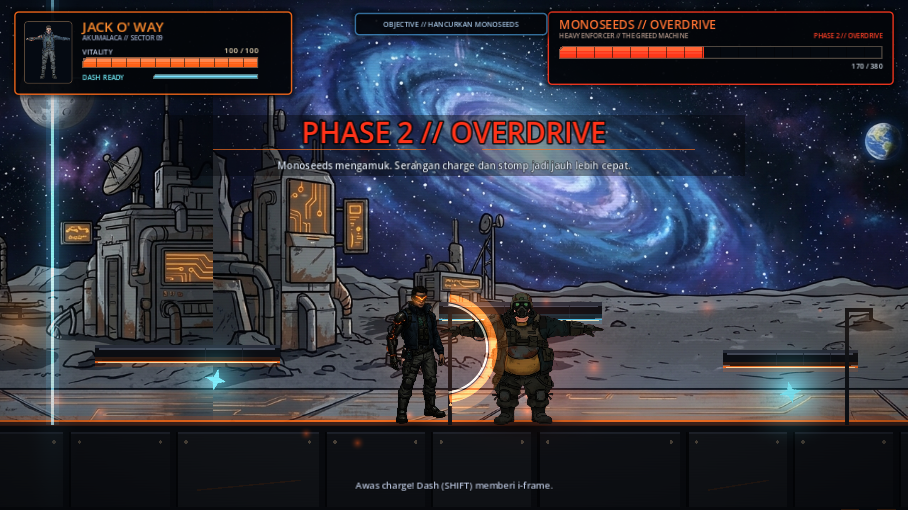
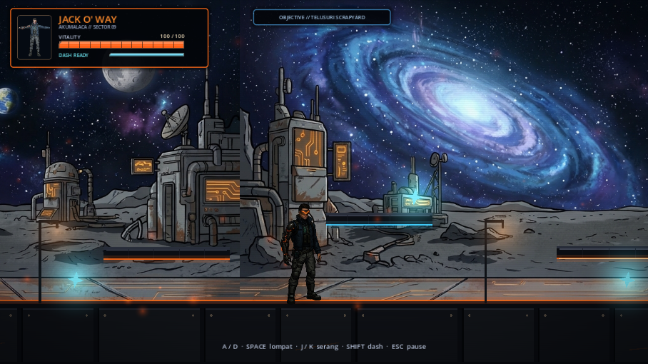
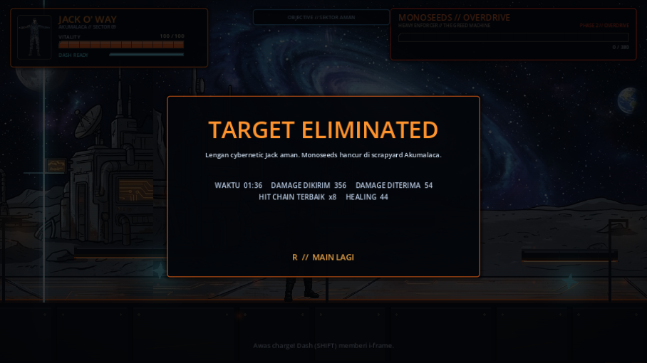

# JACK O' WAY: AKUMALACA

**2D cinematic action-brawler — Godot 4 / GDScript**

Jack O' Way terjebak di scrapyard planet Akumalaca. Lengan cybernetic-nya jadi incaran
**Monoseeds**, Heavy Enforcer yang menguasai Sektor 09. Bertahan, baca telegraph serangannya,
lalu hancurkan target sebelum lenganmu dijual di black market.



<p align="center">
  
  
</p>

> Prototipe tugas Pemodelan Game. Semua aset karakter berasal dari ilustrasi statis yang
> dianimasikan secara prosedural di dalam Godot (transform, shader, partikel) — tanpa sprite sheet.

---

## ✨ Yang Baru / Highlight

### Feel tempur yang tidak kaku
- **Movement responsif**: akselerasi & friksi, *coyote time*, *jump buffer*, variable jump height,
  dan air control.
- **Dash dengan i-frame** (`SHIFT`) untuk menghindari stomp/charge.
- **Combo 3-hit** (`J` / `K`) dengan damage, reach, knockback, dan timing berbeda.
  Hit ketiga adalah heavy attack yang membuat bos *stagger*.
- **Damage multiplier combo**: makin panjang rantai hit, makin besar damage.
- **Boss dua fase**: Monoseeds berpindah ke **Overdrive** di bawah 50% HP —
  lebih cepat, charge attack, dan telegraph yang lebih agresif.
- **Telegraph jelas**: tanda `!`, aura merah, dan suara peringatan sebelum serangan.
- **Pickup nanite** untuk memulihkan HP di tengah pertarungan.

### Umpan balik visual (juice)
- Hitstop, screen shake, flash layar, dan getaran kamera.
- Angka damage melayang, percikan, debu, afterimage dash, slash arc, dan shockwave.
- Health bar animasi dengan *ghost damage*, segmen, dan pulse saat HP rendah.
- HUD: bar boss, combo counter, indikator cooldown dash, banner misi, hasil akhir + statistik.

### Animasi dari aset statis
- **Jack**: idle breathing, run bob/lean, jump stretch, land squash, dash stretch, attack lunge,
  hurt shake, dan death dissolve.
- **Monoseeds**: idle sway, waddle saat mengejar, crouch telegraph, lunge stomp, charge,
  stagger, phase-2 aura, dan death dissolve.
- **Lingkungan**: parallax, starfield shader berkelip, nebula bergerak, ember naik,
  lampu berdenyut, platform underglow, dan barrier energi.
- Shader `character.gdshader` untuk hit flash, aura, dan dissolve.

### Audio
- SFX prosedural (jump, slash, hit, hurt, windup, charge, shockwave, heal, victory, defeat).
- Musik ambient loop orisinal yang dibuat khusus untuk prototipe ini.
- `M` untuk mute.

---

## 🎮 Kontrol

| Tombol | Aksi |
|---|---|
| `A` / `D` atau `←` / `→` | Bergerak |
| `SPACE` / `W` / `↑` | Lompat (tahan untuk lompat lebih tinggi) |
| `J` / `K` | Serangan combo 3-hit |
| `SHIFT` | Dash (i-frame) |
| `ESC` / `P` | Pause |
| `R` | Ulangi setelah menang / kalah |
| `M` | Mute audio |

---

## 🚀 Menjalankan

1. Clone repo ini.
2. Buka **Godot 4** (diuji di **Godot 4.7.2**; disarankan Godot 4.7+).
3. Pilih **Import**, lalu arahkan ke `game/project.godot`.
4. Tekan **F5**.

Tidak memerlukan plugin, asset store, atau koneksi internet.

---

## 📁 Struktur Repo

```text
.
├── game/                      # Proyek Godot 4 (satu-satunya source of truth)
│   ├── assets/
│   │   ├── audio/             # SFX + musik ambient
│   │   ├── backgrounds/       # Key art planet Akumalaca
│   │   ├── characters/        # Jack & Monoseeds
│   │   └── fx/                # Tekstur partikel runtime
│   ├── scripts/
│   │   ├── main.gd            # Direktur game, kamera, alur misi
│   │   ├── player.gd          # Movement, combo, dash, animasi Jack
│   │   ├── enemy.gd           # AI & state machine Monoseeds
│   │   ├── hud.gd             # HUD, banner, pause, result
│   │   ├── fx.gd              # Partikel, damage number, afterimage
│   │   └── ...
│   ├── shaders/               # Karakter, starfield, vignette
│   ├── Main.tscn
│   └── project.godot
├── docs/
│   ├── lore/                  # Latar planet & konsep Monoseeds
│   ├── characters/            # Referensi & moodboard Jack O' Way
│   ├── art/                   # Concept art & key art
│   ├── screenshots/           # Screenshot untuk README
│   └── referensi_gameplay.md
├── modul/                     # Materi kuliah — di-ignore oleh Git
└── README.md
```

Struktur lama yang duplikat (`tugas uts/` dan salinan project di
`kumpul tugas project tengah semester/`) sudah dikonsolidasikan ke satu proyek di `game/`.
File `.import` yang yatim dan aset ganda juga sudah dibersihkan.

---

## 🧠 Catatan Desain

- Aset karakter yang tersedia adalah ilustrasi **pose depan / T-pose**, bukan sprite sheet
  side-view. Karena itu animasi dibangun lewat *procedural rig* sederhana: pivot di dada,
  scale/rotation/offset, shader flash, dan partikel. Hasilnya tetap hidup tanpa perlu
  menggambar ulang aset.
- Arena memakai satu background key art yang diparallax, ditambah shader bintang dan lapisan
  glow agar tidak terasa datar.
- Semua UI, bar HP, efek, dan tekstur partikel dibuat runtime (kecuali key art, karakter,
  dan audio) supaya repo tetap ringan.

---

## 📚 Dokumentasi & Referensi

- [Latar belakang planet Akumalaca](docs/lore/latar_belakang_planet_akumalaca.md)
- [Konsep cerita Monoseeds](docs/lore/konsep_story_monoseeds.md)
- [Referensi karakter Jack O' Way](docs/characters/referensi_jack_o_way.md)
- [Analisis referensi Jack O' Way](docs/characters/analisis_referensi_jack_o_way.txt)
- [Catatan hasil game & referensi](docs/referensi_gameplay.md)
- Concept art & moodboard ada di [`docs/art/`](docs/art) dan [`docs/characters/`](docs/characters)

---

## 🛠️ Built With

- **Engine:** Godot Engine 4 (GL Compatibility)
- **Language:** GDScript
- **Visual:** custom asset pack + procedural FX & animation
- **Audio:** procedurally generated SFX + ambient loop

---

## 👤 Credits

- **Game Design & Programming:** pemilik repo / mahasiswa Pemodelan Game
- **Karakter & Key Art:** aset tugas Pemodelan Game
- **Engine:** [Godot Engine](https://godotengine.org)

---

*Dibuat untuk tugas Pemodelan Game — Sektor 09, Akumalaca.*
